# Các sơ đồ DocLint — dự thảo thiết kế 0.1

Các hình dưới đây dùng các góc nhìn khác nhau; không có một sơ đồ duy nhất thay thế SRS, kiểm thử và quyết định sản phẩm. Đọc cùng [định hướng](01-PRODUCT.md), [yêu cầu](02-REQUIREMENTS.md) và [kiến trúc](03-ARCHITECTURE.md).

Mở hình SVG để phóng to. Mã Mermaid chỉnh sửa được nằm trong thư mục `diagrams`. Thiết kế đích và hiện trạng được phân biệt ở mô tả từng hình.

## D01. Bối cảnh hệ thống

Xác định ai sử dụng và sản phẩm trao đổi thông tin gì với bên ngoài. Bộ dựng và hàng đợi là chi tiết bên trong, không được coi như người dùng nghiệp vụ.


[Mở hình SVG](rendered/D01-context.svg) · [Mã nguồn sơ đồ](diagrams/D01-context.mmd)

Xem bản Mermaid

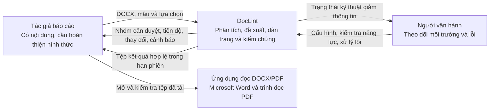

## D02. Các ca sử dụng

Biểu diễn mục tiêu tác nhân bằng flowchart Mermaid; đường liên kết không thể hiện thứ tự thực hiện. Đây là mô hình ca sử dụng, không phải bản UML dùng đầy đủ ký pháp actor/include/extend.


[Mở hình SVG](rendered/D02-use-cases.svg) · [Mã nguồn sơ đồ](diagrams/D02-use-cases.mmd)

Xem bản Mermaid

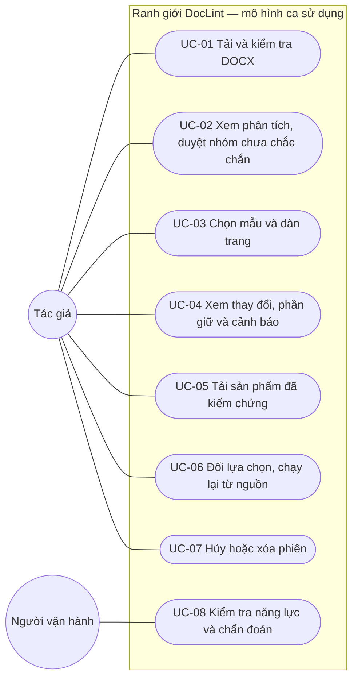

## D03. Luồng hoạt động nghiệp vụ

Các nhánh kiểm tra đầu vào, duyệt, lập kế hoạch, sửa và công bố. Kế hoạch có thể không có operation nếu chỉ bảo tồn. Việc giữ nguyên toàn tệp vẫn cần kiểm chứng và giải thích phạm vi.


[Mở hình SVG](rendered/D03-activity.svg) · [Mã nguồn sơ đồ](diagrams/D03-activity.mmd)

Xem bản Mermaid

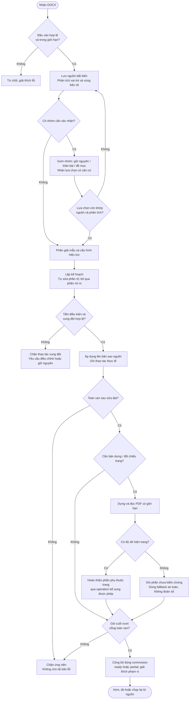

## D04. Thành phần và hướng phụ thuộc

Kiến trúc đích đề xuất. Mũi tên liền biểu diễn phụ thuộc/sử dụng; nét đứt biểu diễn adapter hiện thực cổng. Không khẳng định mọi module đích đã có lớp hiện thực trong mã hiện tại.


[Mở hình SVG](rendered/D04-components.svg) · [Mã nguồn sơ đồ](diagrams/D04-components.mmd)

Xem bản Mermaid

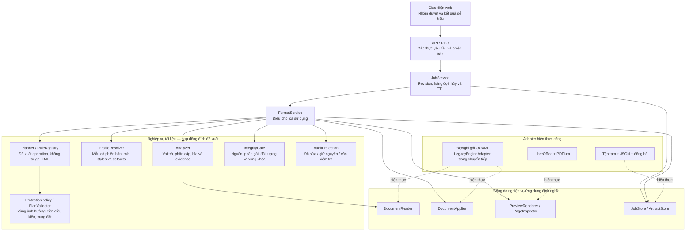

## D05. Trình tự dàn trang và công bố

Minh họa hợp đồng đích của một lượt xử lý, gồm nhận bất đồng bộ và cổng kiểm chứng. Luật hủy/TTL và các lỗi khác phải đọc cùng D07, không suy ra rằng sơ đồ đã liệt kê mọi ngoại lệ.

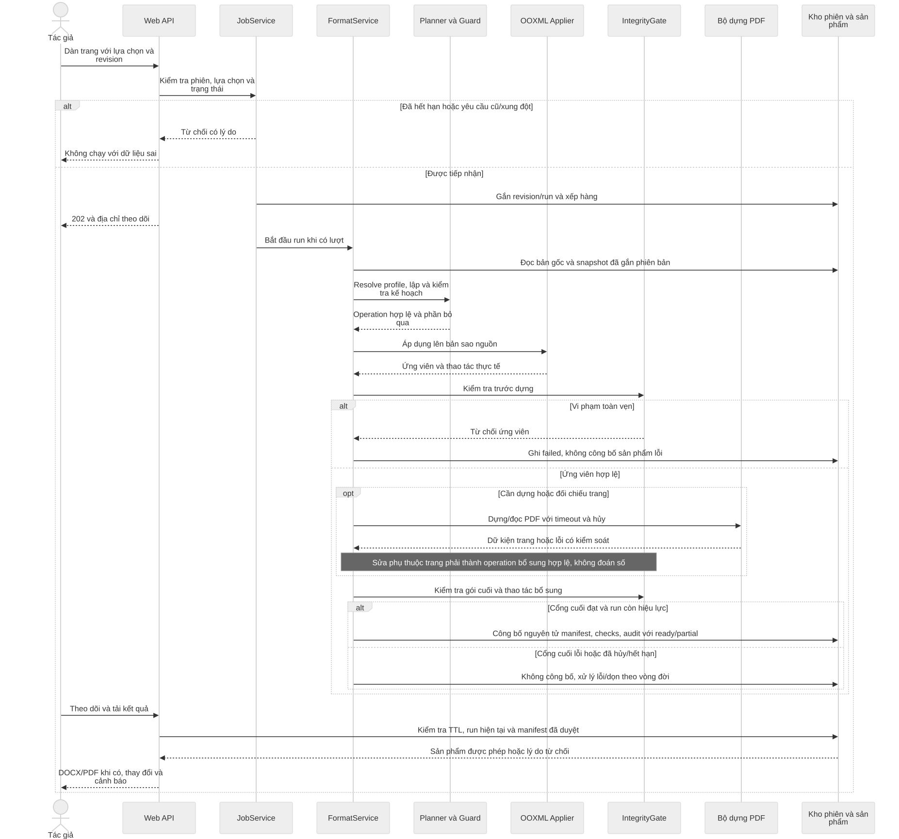

[Mở hình SVG](rendered/D05-sequence.svg) · [Mã nguồn sơ đồ](diagrams/D05-sequence.mmd)

Xem bản Mermaid

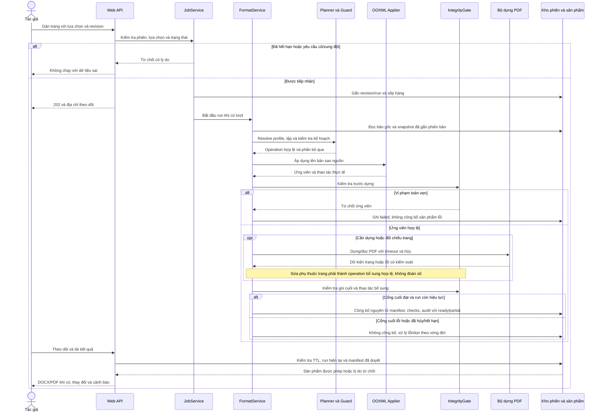

## D06. Mô hình dữ liệu khái niệm

Các quan hệ thuộc phiên tạm thời. Có thể hiện thực bằng JSON/tệp; không yêu cầu tạo các bảng SQL. ID khối nằm trong AnalysisSnapshot, không được coi là định danh vĩnh viễn.


[Mở hình SVG](rendered/D06-data-model.svg) · [Mã nguồn sơ đồ](diagrams/D06-data-model.mmd)

Xem bản Mermaid

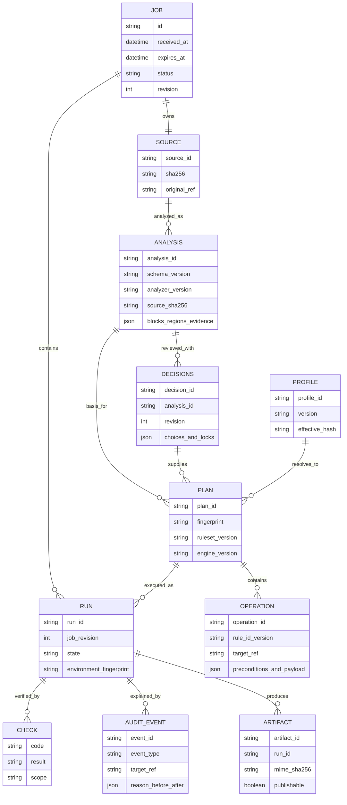

## D07. Vòng đời phiên và trạng thái

Các trạng thái vận hành dựa trên V1; hết hạn logic được tách khỏi thời điểm dọn vật lý. Ready/partial đều phải qua cổng toàn vẹn trước tải, và partial không có nghĩa mọi yêu cầu đã được làm.


[Mở hình SVG](rendered/D07-job-lifecycle.svg) · [Mã nguồn sơ đồ](diagrams/D07-job-lifecycle.mmd)

Xem bản Mermaid

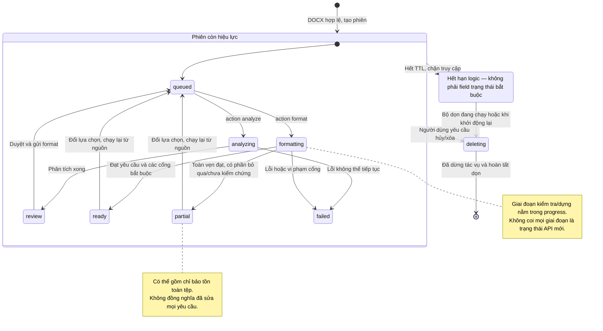

## D08. Triển khai beta và phương án máy chủ

Beta Windows/Quick Tunnel là cách đang hướng dẫn sử dụng. Phần máy chủ là phương án đích, không phải dịch vụ 24/7 đã triển khai. Không cần chạy đồng thời cả hai nhánh.


[Mở hình SVG](rendered/D08-deployment.svg) · [Mã nguồn sơ đồ](diagrams/D08-deployment.mmd)

Xem bản Mermaid

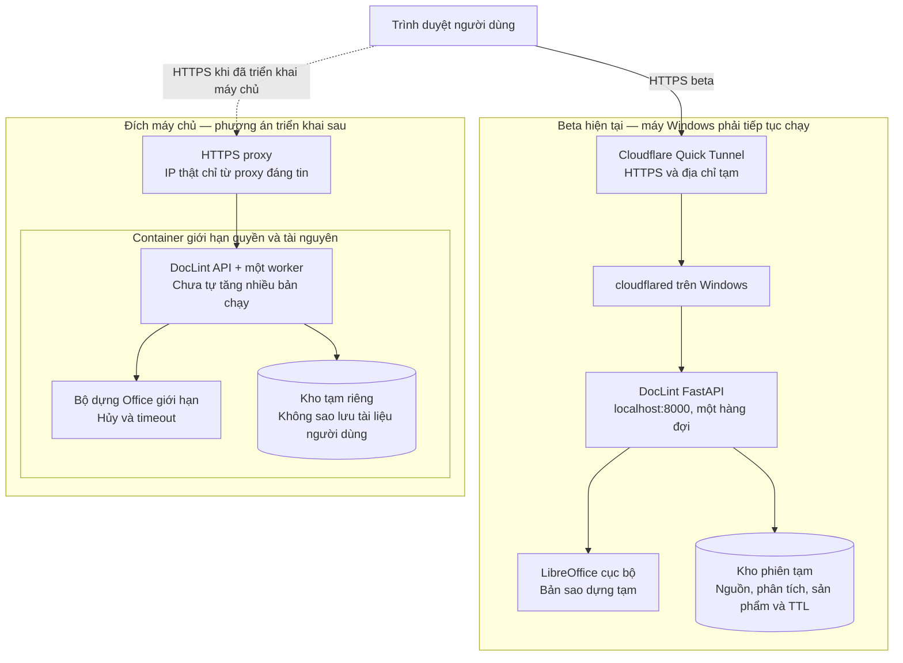

## D09. Vòng lặp phát triển và kiểm chứng

Một thay đổi đi từ vấn đề/AC đến bằng chứng và phản hồi. Thiết kế được cập nhật khi bị ảnh hưởng; không yêu cầu viết lại mọi tài liệu cho một thay đổi nhỏ.


[Mở hình SVG](rendered/D09-development-process.svg) · [Mã nguồn sơ đồ](diagrams/D09-development-process.mmd)

Xem bản Mermaid

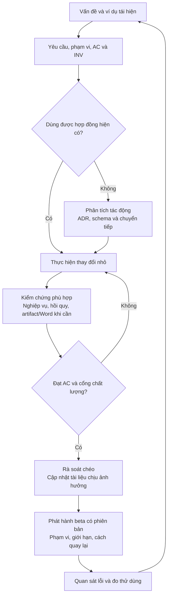

## D10. Luồng dữ liệu phân rã

Mô hình DFD mức phân rã đầu tiên theo tiến trình P1–P6; kho D1–D5 là kho logic. D3 chứa ứng viên chưa công bố, không phải đường tải công khai. D05 mô tả thứ tự/cổng trước dựng và sau dựng chi tiết hơn.


[Mở hình SVG](rendered/D10-data-flow.svg) · [Mã nguồn sơ đồ](diagrams/D10-data-flow.mmd)

Xem bản Mermaid

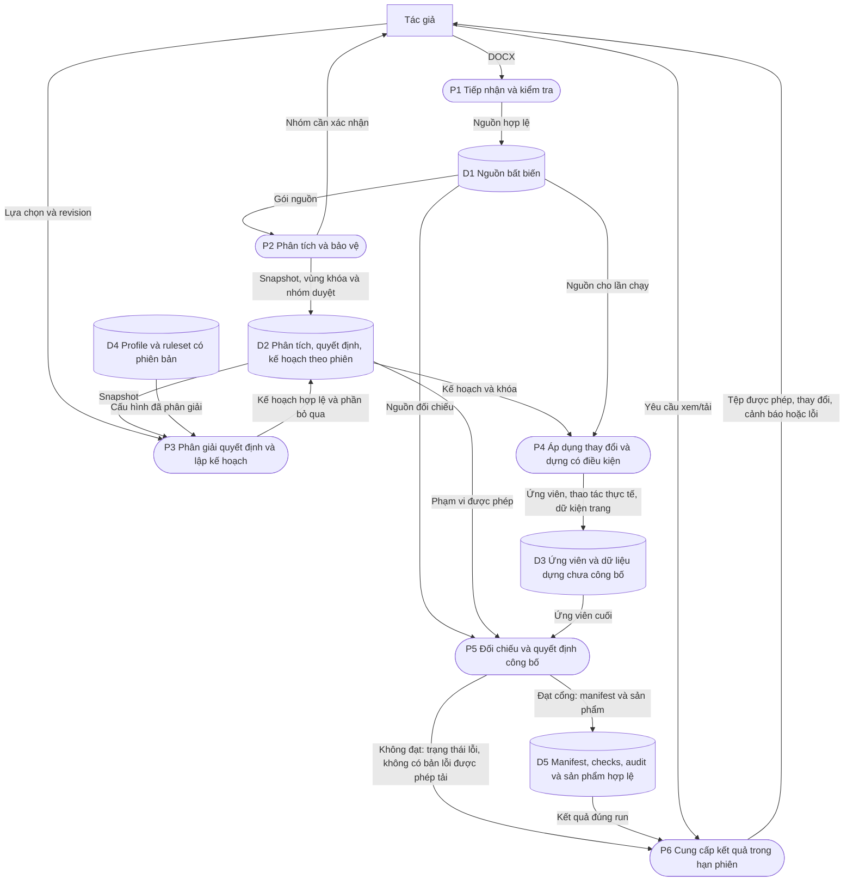

